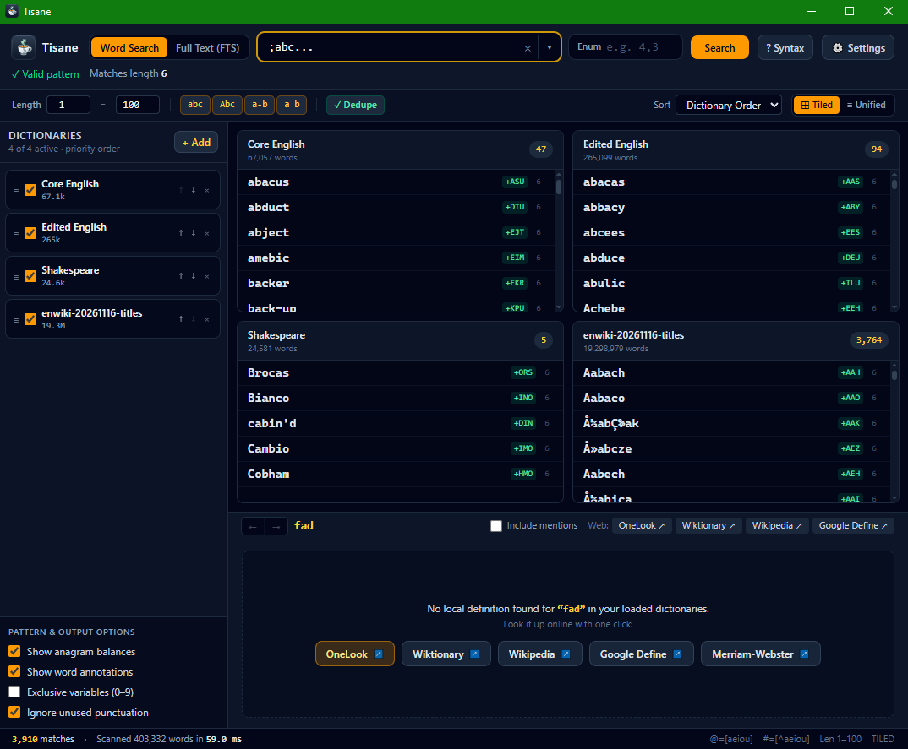

#  Tisane

**Tisane** is a pattern matching/regex tool. It provides high-speed crossword, cryptic, anagram, and dictionary search. It can operate on custom user-defined dictionaries.



## Installing

Installing Tisane is done by downloading the latest release from the [releases page](https://github.com/beckbria/tisane/releases) and extracting the archive to a location on your computer.

## Using Tisane

### Dictionaries

A limited number of publicly available dictionaries are included in the releases. If you own a copy of TEA, dictionaries that came with it (found in `C:\Program Files (x86)\Crossword Man\TEA Crossword Helper 2.11\Dictionaries\`) can be used with Tisane. Some other dictionaries can be found in the [tisane-dictionaries repository](https://github.com/beckbria/tisane-dictionaries).

### Pattern Syntax Summary

| Syntax | Meaning | Example |
| :--- | :--- | :--- |
| `.` | Any single letter | `c.o..w.rd` → `crossword` |
| `?` | Optional single letter (0 or 1) | `colou?r` → `color`, `colour` |
| `*` | Zero or more letters | `anti*dis*` |
| `[abc]` / `[^abc]` | Character choice list / negated choice list | `[^aeiou]at` → `bat`, `cat`, … |
| `;letters` | Anagram letter pool (usable with `.`, `?`, `*`) | `;listen` → `enlist`, `silent`, `tinsel` |
| `template;pool` | Template constrained by anagram pool | `m.....r;aadmort*` → `matador` |
| `(sub)` | Contiguous subpattern (can be anagrammed with `;`) | `*(cat)*` or `*(;act)*` |
| `0`–`9` | Positional equality variables | `123321` (6-letter palindromes) |
| `@` / `#` | User macros (defaults: `@` = `[aeiou]`, `#` = `[^aeiou]`) | `@#@#@#` |
| `&` `\|` `!` `( )` | Boolean AND, OR, NOT, and grouping | `;retinas* & !s*` |
| `\` | Escape special character literally | `\-\'` |

### Desktop UI Guide & Keyboard Shortcuts

- **Dictionary Sidebar (Left)**:
  - Click **+ Add** (`Ctrl+O`) to register `.tsd` dictionary files via the native file picker.
  - Toggle checkboxes to enable or disable dictionaries for the active search.
  - **Drag and drop** rows (`≡`) or click **`↑` / `↓`** to set dictionary priority order (controls tiled pane order, `Dictionary Order` sort, and cross-dictionary duplicate suppression).
  - Badges indicate total word count plus `defs` (local definitions) and `fts` (Full-Text Search index) capabilities.
- **Results Workspace (Center)**:
  - **Separate Tiled Panes (`⊞ Tiled`, default)**: Displays an independently virtualized scrollable pane with match counts for each enabled dictionary side-by-side.
  - **Unified Merged List (`≡ Unified`)**: Merges hits across all enabled dictionaries into a single virtualized list with `[Dictionary]` source tags.
  - Both modes handle 100,000+ streaming matches smoothly and display optional annotations, `-OMITTED` / `+ADDED` anagram balance pills, and local-definition indicators.
- **Pattern & Filter Bars (Top)**:
  - Switch between Word Search and Full Text (FTS) modes.
  - Live validation previews matched word-length bounds or highlights exact syntax error spans as you type.
  - Constrain **Enum** (e.g., `4,3` or `4-2-2` in Word Search mode), **Min / Max Length** (`1–100`, click `–` to pin `=` exact length), **Entry Categories** (`abc` lowercase, `Abc` capitalized, `a-b` punctuated, `a b` phrases), **Dedupe**, and **Sort** (`Dictionary Order`, `Smart Balance`, `A → Z`, `Z → A`, `Length ↑`, `Length ↓`).
- **Definitions & Web Search Fallback (Bottom)**:
  - Click any matched word to view sanitized RTF definitions across your dictionaries.
  - Double-click any word inside a definition to cross-lookup that word; navigate lookup history with the arrow buttons.
  - Toggle **Include mentions** to also surface entries where the word appears in the definition body via FTS.
  - When no local definition is available (or from the header bar at any time), click on a dictionary provider to do a web search. You can configure your own custom `{entry}` URL templates in Settings.

| Shortcut | Action |
| :--- | :--- |
| `Ctrl+W` / `Cmd+W` | Switch to **Word Search** mode and focus pattern bar |
| `Ctrl+F` / `Cmd+F` | Switch to **Full Text Search (FTS)** mode and focus pattern bar |
| `Enter` | Start search |
| `Escape` | Cancel active search (or close open modal/popover) |
| `Alt+Down` | Open recent queries dropdown |
| `Ctrl+1` / `Cmd+1` | Switch results to **Separate Tiled Panes** (`⊞ Tiled`) |
| `Ctrl+2` / `Cmd+2` | Switch results to **Unified Merged List** (`≡ Unified`) |
| `Ctrl+O` / `Cmd+O` | Add `.tsd` dictionary files |
| `Ctrl+,` / `Cmd+,` | Open **Preferences** (macros & web search providers) |
| `F1` | Toggle **Pattern Syntax Quick Reference** |
| `Up` / `Down` (in pane) | Move selection through virtualized results and update definition |

### CLI

`tisane-cli` accepts both modern POSIX flags and legacy `TEACON.exe` switches (`/D:`, `/S:`, `/L:`, `/A:`, `/H:`, `/B:`, `/N:`, `/O:`, `/X:`, `/U:`, `/Q`, `/?`). It can be used for a single query or in an interactive mode (`-i`) and can output plain text or structured formats.

```bash
# Basic crossword template & anagram query against specific dictionaries
./tisane-cli -d "Core English;The Devil's Dictionary" "c.o..w.rd"

# Sub-anagram search sorted by Smart Balance (exact anagrams first)
./tisane-cli -d "Core English" --sort smart -b ".....*;aadmort"

# Crossword enumeration shorthand (4-letter word, space, 3-letter word)
./tisane-cli -d "Core English" --enum 4,3 ";icecream*"

# Exclude multi-word phrases and proper nouns
./tisane-cli -d "Core English" --no-phrases --no-proper "c.t*"

# Full-Text Search (FTS) across dictionary definitions
./tisane-cli -d "The Devil's Dictionary" -F "blackguard & vision"

# View formatted terminal definitions (prints web lookup URLs if no local definition exists)
./tisane-cli -d "The Devil's Dictionary" --define cynic

# Structured JSON, JSONL, or CSV output for scripting / jq
./tisane-cli -d "Core English" --format json --dedupe --show-dict ";listen"

# Interactive REPL mode with command history and :commands (:help, :dicts, :len, :fts, :def)
./tisane-cli -d "Core English;The Devil's Dictionary" -i

# Legacy TEACON-compatible batch/switch invocation
./tisane-cli "/D:Core English" /S:7 /L:7 /O:4 ";aadmort"
```

Run `./tisane-cli --help` for the complete list of flags.

### Dictionary Builder (`tisane-build`)

`tisane-build` compiles UTF-8 or Windows-1252 word/definition text files into compressed `TSD1` `.tsd` dictionaries (with optional `.tsm` custom alphabet maps and inverted FTS indexes), or inspects headers of existing `.tsd` files.

```bash
# Inspect metadata, version, capabilities, and word counts of existing .tsd files
./tisane-build --info "Dictionaries/Core English.tsd" "Dictionaries/The Devil's Dictionary.tsd"

# Compile a plain word list or | / RTF definition file into a .tsd dictionary
./tisane-build -d "Custom Crossword List" words.txt custom.tsd

# Compile using a custom .tsm alphabet/transliteration map and TSV annotations
./tisane-build --map Maps/French.TSM --tsv -i lexicon.tsv -o french.tsd
```

#### Input File Syntax Summary
- **Simple word list**: One entry per line, optional `;annotation` (or `\tannotation` with `--tsv`).
- **Definitions**: `headword;optional_qualifier|definition text` (supports plain text or `{\rtf1 ...}` RTF blocks; multiple headwords/aliases sharing one definition can be separated by `|` before the final definition segment, matching `TSBuild` format).

Run `./tisane-build --help` for all builder flags (`--min-len`, `--max-len`, `--max-fts-pct`, `--no-sort`, `--encoding`).

### Dictionary Extractor

`tisane-extract` exports words from any `.tsd` (`TSD0` or `TSD1`) dictionary either as a clean one-word-per-line list (`--simple`, default) or as a `tisane-build`-compatible metadata source file (`--metadata`, preserving description headers, `+annotations`, `+qualifiers`, `:shared` headwords, `;aliases`, and `|definitions`).

```bash
# Simple mode (default): one word per line to stdout or file, discarding definitions & annotations
./tisane-extract "Dictionaries/Core English.tsd" > words.txt
./tisane-extract --simple "Dictionaries/The Devil's Dictionary.tsd" devils-words.txt

# Metadata mode: full tisane-build / TSBuild source format (headwords, annotations, aliases, definitions)
./tisane-extract --metadata "Dictionaries/The Devil's Dictionary.tsd" devils-source.txt

# Metadata without definitions: keep word+annotation pairs only, discarding definitions & qualifiers
./tisane-extract --metadata --no-defs "Dictionaries/tsbuild2.tsd" annotated-words.txt

# Filter extracted words by canonical letter length (e.g. 5-letter words only) and stream by length bucket
./tisane-extract --min-len 5 --max-len 5 --sort length "Dictionaries/Core English.tsd" fives.txt

# Also extract the dictionary's embedded .tsm alphabet map for recompilation with tisane-build
./tisane-extract --metadata --save-map custom.tsm custom.tsd custom-source.txt
```

Run `./tisane-extract --help` for all extractor options (`--no-header`, `--no-dedupe`, `--sort`, `--encoding`).

## Pattern Matching Tools

### Comparison to TEA

Tisane takes significant inspiration from (and owes great thanks to) the classic Win32 **TEA** by Ross Beresford ([Crossword Man](http://www.rossberesford.com/crosswordman)). TEA is no longer available for purchase, but Tisane provides a modern UI compatible for TEA users. The dictionary files included with TEA are not included in this repository.

Tisane's query syntax is borrowed from TEA and its dictionary files are identical. If you purchased TEA and have dictionary files created for it, those files can be used with Tisane.

* `tisane-cli` respects the CLI switches from `TEACON.EXE` and can be used as a drop-in replacement. 
* `tisane-build` is a command-line tool to build new dictionary files from word lists
* `tisane` is a desktop GUI application whose default interface is similar to that of TEA

Tisane contains features and performance improvements not included in TEA, described below.

### Comparison to Nutrimatic

[Nutrimatic](https://nutrimatic.org) is another excellent modern pattern searching engine which makes a different tradeoff between exhaustive search and ranking.

Nutrimatic ranks likely words and multi-word phrases utilizing usage frequency data, but does a best-first search which may not enumerate all possible results. It also filters out many punctuation and diacritic combinations which Tisane preserves.

## Development

### Prerequisites

Installing `bazel` (or [Bazelisk](https://github.com/bazelbuild/bazelisk) on Windows) will manage dependencies.  `bazel build ...` will install the necessary tools.

#### Frameworks used in Tisane

1. **Go 1.24+** (`go version`)
2. **Node.js 20+ and npm** (required when building or developing the `cmd/tisane` Svelte 5 frontend bundle)
3. **Desktop WebView runtime** (for running the `tisane` desktop window):
   - **Linux (Ubuntu / Debian)**: `libgtk-3-0` and `libwebkit2gtk-4.1-0` (installed by default on most desktop distributions).
     - *Note*: Tisane supports Wails v3's **PureGo** Linux backend (`-tags purego,gtk3`), so **no C compiler (`gcc`), `pkg-config`, or `-dev` header packages** are required to build on Linux.
     - On GTK4 + WebKitGTK 6.0 distributions, use `-tags purego` instead of `-tags purego,gtk3`.
   - **macOS**: Built-in `WKWebView` (Xcode Command Line Tools if building with `cgo`).
   - **Windows**: Built-in Microsoft Edge `WebView2` runtime.

---

### Repository Layout

| Path | Description |
| :--- | :--- |
| `artifacts` | Design documents and work plans |
| `cmd/tisane` | **Desktop GUI application** (Go + Wails v3 + Svelte 5 + Tailwind CSS + `@tanstack/svelte-virtual`) |
| `cmd/tisane-cli` | **Command-line & interactive REPL search tool** (compatible with legacy `TEACON` switches plus JSON/CSV, FTS, `--define`, and `--enum`) |
| `cmd/tisane-build` | **Dictionary compiler & inspector** (replaces `TSBuild.exe`; compiles plain-text/RTF word lists into `.tsd` files) |
| `cmd/tisane-extract` | **Word list & metadata extractor** (exports `.tsd` dictionaries to plain one-word-per-line lists or `tisane-build` source files) |
| `pkg/tsd` | Pure-Go reader, streaming bit-unpacker, RTF/zlib definition decoder, and byte-accurate `TSD1` writer |
| `pkg/pattern` | Macro expander, boolean expression parser, live span validator, calibration-sorted compiler, and backtracking VM |
| `pkg/search` | Concurrent multi-dictionary word & indexed/sequential Full-Text Search (FTS) engine with 6 sort modes |
| `pkg/lookup` | Sanitized `.tsd` RTF-to-HTML / plain-text converter and `{entry}` web lookup URL builder |
| `pkg/profile` | Portable configuration (`~/.config/tisane/config.toml`) and `.tsd` dictionary discovery |

---


### Building and Running the Desktop UI (`tisane`)

The `tisane` desktop binary embeds the compiled Svelte 5 frontend from `cmd/tisane/frontend/dist` via Go's `//go:embed`. Always build the frontend assets at least once before compiling `./cmd/tisane`.

#### Step 1: Build the Svelte 5 Frontend Bundle

```bash
cd cmd/tisane/frontend
npm install
npm run build
cd ../../..
```

This outputs the production HTML/CSS/JS bundle into `cmd/tisane/frontend/dist/`.

#### Step 2: Compile the `tisane` Executable

Choose the command matching your platform:

##### Linux (Recommended — PureGo, zero `-dev` headers needed)
```bash
# GTK3 + libwebkit2gtk-4.1 (Ubuntu 22.04 / 24.04 / 26.04, Debian, Mint, Fedora)
CGO_ENABLED=0 go build -tags purego,gtk3 -o tisane ./cmd/tisane

# Or GTK4 + libwebkitgtk-6.0
CGO_ENABLED=0 go build -tags purego -o tisane ./cmd/tisane
```

##### Linux (Traditional CGO build, if `libgtk-3-dev` & `libwebkit2gtk-4.1-dev` are installed)
```bash
CGO_ENABLED=1 go build -o tisane ./cmd/tisane
```

##### macOS & Windows
```bash
go build -o tisane ./cmd/tisane
# On Windows (PowerShell):
# go build -o tisane.exe ./cmd/tisane
```

##### Headless / Browser Server Mode (Any OS, no GUI libraries needed)
Wails v3 can also serve the exact same backend and UI over HTTP for browser or container use:
```bash
CGO_ENABLED=0 go build -tags server -o tisane-server ./cmd/tisane
./tisane-server
# Open http://localhost:8080 in any browser
```

#### Step 3: Run `tisane`

```bash
./tisane
```

You can optionally point Tisane at one or more directories of `.tsd` files or a custom config file via environment variables:

```bash
TISANE_DICT_PATH="/path/to/Dictionaries:/another/folder" ./tisane
```

- **First-run discovery**: On first launch, Tisane automatically scans `TISANE_DICT_PATH`, `./Dictionaries`, `./binary/Dictionaries`, `./binary`, and the working directory for `.tsd` files, and saves your profile to `~/.config/tisane/config.toml` (Linux/macOS) or `%AppData%\tisane\config.toml` (Windows). Override the config file path at any time with `TISANE_CONFIG=/path/to/config.toml`.

### Live Frontend Hot-Reload (UI Development Workflow)

When iterating on Svelte components in `cmd/tisane/frontend/src`:

```bash
# Terminal 1: Start the Vite dev server (defaults to http://localhost:5173)
cd cmd/tisane/frontend
npm run dev

# Terminal 2: Launch Tisane pointed at the Vite dev server
FRONTEND_DEVSERVER_URL=http://localhost:5173 ./tisane
```


### Building and Running the CLI (`tisane-cli`)

#### Build

```bash
CGO_ENABLED=0 go build -o tisane-cli ./cmd/tisane-cli
```

## Dictionary Builder (`tisane-build`)

`tisane-build` compiles UTF-8 or Windows-1252 word/definition text files into compressed `TSD1` `.tsd` dictionaries (with optional `.tsm` custom alphabet maps and inverted FTS indexes), or inspects headers of existing `.tsd` files.

### Usage & Examples

```bash
# Inspect metadata, version, capabilities, and word counts of existing .tsd files
./tisane-build --info "Dictionaries/Core English.tsd" "Dictionaries/The Devil's Dictionary.tsd"

# Compile a plain word list or | / RTF definition file into a .tsd dictionary
./tisane-build -d "Custom Crossword List" words.txt custom.tsd

# Compile using a custom .tsm alphabet/transliteration map and TSV annotations
./tisane-build --map Maps/French.TSM --tsv -i lexicon.tsv -o french.tsd
```

### Input File Syntax Summary
- **Simple word list**: One entry per line, optional `;annotation` (or `\tannotation` with `--tsv`).
- **Definitions**: `headword;optional_qualifier|definition text` (supports plain text or `{\rtf1 ...}` RTF blocks; multiple headwords/aliases sharing one definition can be separated by `|` before the final definition segment, matching `TSBuild` format).

Run `./tisane-build --help` for all builder flags (`--min-len`, `--max-len`, `--max-fts-pct`, `--no-sort`, `--encoding`).

### Dictionary Builder

```bash
CGO_ENABLED=0 go build -o tisane-build ./cmd/tisane-build
```

### Dictionary Extractor

```bash
CGO_ENABLED=0 go build -o tisane-extract ./cmd/tisane-extract
```

### Building with Bazel (Linux & Windows Cross-Compilation)

The repository includes Bzlmod (`MODULE.bazel`) and `rules_go` targets to build Linux binaries, cross-compile Windows `.exe` binaries from inside Linux, and run all tests:

```bash
# Build native Linux binaries (tisane, tisane-cli, tisane-build, tisane-extract)
bazel build //:tisane //:tisane-cli //:tisane-build
# Or build the entire Linux binary group:
bazel build //:linux

# Cross-compile Windows (.exe) binaries from inside Linux
bazel build //:tisane-windows //:tisane-cli-windows //:tisane-build-windows
# Or build the entire Windows binary group:
bazel build //:windows
# Or cross-compile any target via the windows config / platform flag:
bazel build --config=windows //:tisane //:tisane-cli //:tisane-build

# Build distributable release archives (all binaries + bundled dictionaries):
# - bazel-bin/linux-release.tar.gz (Linux binaries + dictionaries/)
# - bazel-bin/windows-release.zip  (Windows .exe binaries + dictionaries/)
bazel build //:linux-release //:windows-release

# Run all Go unit and integration tests via Bazel
bazel test //...
```

### Running Tests & Verification

#### Go Unit, Integration & Race Tests

```bash
# Core libraries, CLI, Builder, Extractor, and Desktop backend services (with race detector)
go test -race ./pkg/... ./cmd/tisane-build ./cmd/tisane-extract ./cmd/tisane-cli ./cmd/tisane/app

# Wails v3 service FQN bindings & embedded asset server check (Linux PureGo)
CGO_ENABLED=0 go test -tags purego,gtk3 -v ./cmd/tisane
```

#### Frontend Type-Check & Vitest Component / Virtualization Suite

```bash
cd cmd/tisane/frontend
npm run check   # svelte-check + TypeScript strict verification
npm test        # Vitest + @testing-library/svelte (includes 200k-item multi-pane virtualization test)
```

## AI Usage Disclaimer

Much of the code in this repository was written with AI-assisted tooling. User-facing documentation, such as this document, is primarily written by humans for humans.
