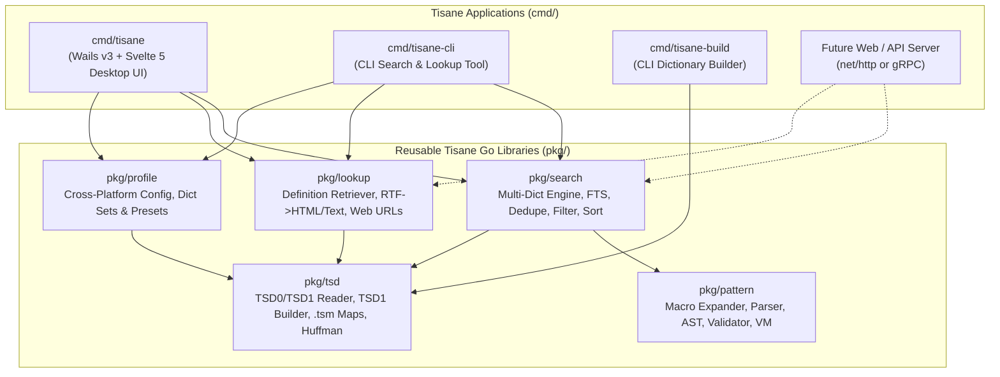
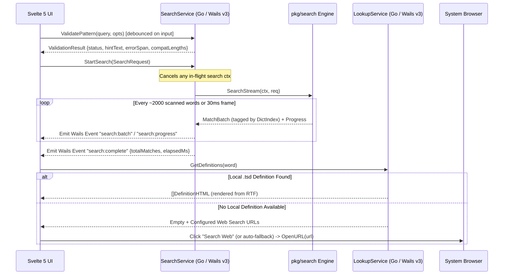

# Tisane Implementation Plan: Go Libraries, CLI, and Wails v3 Desktop App

This plan specifies the architecture and phased implementation of **Tisane** — a modern, cross-platform Go reimplementation of legacy `TEA.exe`, `TEACON.exe`, and `TSBuild.exe`, grounded in the binary format specification ([TEA_Dictionary_Format.md](TEA_Dictionary_Format.md)) and pattern/search syntax specification ([pattern_syntax.md](pattern_syntax.md)).

---

## 1. Module & Package Architecture

The repository defines a single Go module (`module tisane`, targeting **Go 1.23+**) that separates zero-UI core libraries under `pkg/` from executable frontends under `cmd/`. Every `pkg/*` library is pure Go (`CGO_ENABLED=0`), concurrency-safe, context-aware, and free of OS/GUI dependencies so it can equally power the **Tisane** desktop app, `tisane-cli`, `tisane-build`, or a stateless/stateful HTTP/gRPC web backend.



### Repository Layout

> [!NOTE]
> The Go module, binaries, configuration paths, environment variables, and all internal code symbols use **`tisane`**.

```text
tea/
├── go.mod                  # module tisane
├── pkg/
│   ├── tsd/                # Binary .tsd (TSD0/TSD1) reader, TSD1 writer/builder, .tsm charsets
│   ├── pattern/            # Pattern lexer, macro expander, AST, live validator & bytecode VM
│   ├── search/             # Multi-dictionary word & FTS coordinator, deduplication, filters, sorting
│   ├── lookup/             # Local .tsd definition decoder, RTF converter, web lookup URL builder
│   └── profile/            # TOML user profiles (dictionary order, macros, lookup templates)
└── cmd/
    ├── tisane-cli/         # TEACON-compatible CLI query tool + FTS, definitions, REPL & JSON
    ├── tisane-build/       # CLI tool to compile word/definition lists into .tsd files
    └── tisane/             # Wails v3 desktop application ("Tisane")
        ├── main.go
        ├── app/            # Bound Wails v3 Go services (DictService, SearchService, LookupService)
        └── frontend/       # Svelte 5 + TypeScript + Tailwind CSS + @tanstack/svelte-virtual
```

---

## 2. Core Go Libraries (`pkg/*`)

### 2.1 `pkg/tsd` — Dictionary File Reader, Writer & Builder

Handles all binary `.tsd` and `.tsm` operations described in [TEA_Dictionary_Format.md](TEA_Dictionary_Format.md):

- **Concurrency-Safe Backing Store (`io.ReaderAt`)**:
  - `tsd.Open(path string)` opens `*os.File` (or optional `mmap`) and parses only the ~12 KB metadata header, `CharEntry[256]` Huffman/alphabet table, 8-bit lookahead table, and `Calibration` matrix into an immutable `*tsd.Dictionary`.
  - Unlike legacy `InputEngine` (which used stateful `Seek` + `ReadFile`), all word-stream, link-index, FTS-index, and definition reads use **`io.SectionReader` over `io.ReaderAt`** (`pread` on Linux/macOS, `OVERLAPPED` `ReadFile` on Windows). Multiple goroutines or HTTP requests can search the same `*tsd.Dictionary` in parallel with **zero lock contention and zero file-handle exhaustion**.
  - `tsd.OpenBytes(data []byte)` wraps `bytes.Reader` for embedded dictionaries, unit tests, or WASM/cloud deployments.
- **Character Encoding Normalization**:
  - Existing `.tsd` dictionaries encode raw bytes in Windows-1252 (`CP1252` — e.g., `0xE9 = 'é'`, smart quotes/dashes in definitions). `pkg/tsd` exposes clean UTF-8 strings (`Word`, `Annotation`, `Description`) at the Go API boundary while preserving exact raw CP1252 byte mapping internally for `\c` case/accent-exact escapes and Huffman encoding.
- **Streaming Word & Link Decoder**:
  - `dict.ScanLength(length int) iter.Seq2[RawEntry, error]` decodes words of length `L` using the 256-entry 8-bit Huffman lookahead table (`fastSym[256]`, `fastBits[256]`) + 16 KB pooled byte buffers, yielding zero-allocation `RawEntry` views (`CanonicalLetters []byte`, `RawBytes []byte`, `HasAnnotation bool`, `LinkGroupIndex int32`) and materializing `string` copies only for matched entries.
- **Dictionary Writer & Builder (`tsd.Builder`)**:
  - Full `TSD1` compilation pipeline:
    1. Reads `.tsm` character maps (shipping the built-in English default map so `.tsm` is optional) and word/definition inputs (plain word lists, `word\tannotation` lists, or definition markup).
    2. Normalizes canonical letters, buckets entries by canonical letter count (`1..100`), deduplicates identical display strings, and builds link groups + inverted FTS word-occurrence lists.
    3. Builds the length-limited Huffman code table, computes the position-specific calibration matrix, XOR-`0xBD` encodes definitions, and writes valid `TSD1` files compatible with both Tisane and legacy `TEA.exe`.

---

### 2.2 `pkg/pattern` — Pattern Parser, Validator & Bytecode Matcher

Implements the full syntax and semantics documented in [pattern_syntax.md](pattern_syntax.md) in two cleanly decoupled stages:

1. **Dialect-Accurate Parser & Live Validator (`pattern.Parse`)**:
   - Performs single-pass `@` / `#` macro expansion (tracking source offsets back to the unexpanded input), splits logical `&`, `|`, `!`, disambiguates logical `(...)` vs. sub-pattern `(...)`, and Optional Crossword Enumeration expansion (`--enum`), producing an inspectable **`pattern.Expr` AST**.
   - Returns structured `ValidationResult`:
     - Exact status/hint code (`StatusValid`, `StatusEmpty`, `ErrInvalidChoiceList`, ..., `ErrEmptyChoiceList`) so Tisane's GUI and REPL can display live guidance while the user types (e.g., *"Choice list started - use `]` to complete it"*).
     - Byte/rune span `[Start, End]` of any syntax error for inline squiggly-underline highlighting in the GUI and column carets in `tisane-cli`.
     - Pre-check warnings when boolean branches match disjoint length sets (*"Patterns match incompatible lengths"*), **fixing legacy TEA's `mode = 1` negation quirk** so queries like `.. & !*ing` accurately include length `2`.

2. **Dictionary-Bound Compiler & Fast VM (`pattern.Compile(expr, dict, CompileOptions)`)**:
   - Compiles each atomic `Pattern` against a target `*tsd.Dictionary`'s alphabet and calibration matrix:
     - **256-bit Choice Bitmasks (`[4]uint64`)**: Replaces linear choice-list scans (`0xf1`) with single-instruction bit-tests `(mask[letter>>6] >> (letter&63)) & 1`.
     - **Calibration-Sorted Fixed Checks**: Orders positional template checks ascending by `dict.Calibration(length, pos, letter)` so rare letters fail immediately.
     - **Specialized Fast Matchers**:
       - `fixedTemplateMatcher`: Pure slice-indexed loop for crossword templates like `.l...r.n` or `[bc]..t`.
       - `anagramMatcher`: Histogram + exact `budget = min(0, L - A_min)` omission/addition solver for `;lobikes`, `;eiknrr.`, `.....*;aadmort`.
       - `generalVMMatcher`: Backtracking VM handling `*`, letter variables `0`–`9` (exclusive and non-exclusive), recursive sub-patterns `(;orange)` / `;rebel(ada)`, `\c` case/accent-exact checks, and `IgnoreUnusedPunctuation` modes.
   - **Anagram Balance Formatter**: Computes `+ADDED` and `-OMITTED` strings in canonical dictionary order and exposes `BalanceLen() int` for `Smart` length sorting.

---

### 2.3 `pkg/search` — Multi-Dictionary Search, FTS, Filtering & Sorting

Provides the high-level orchestration layer used by `tisane`, `tisane-cli`, and future web servers:

```go
type Request struct {
    Query                   string
    Dictionaries            []*tsd.Dictionary // Ordered by user priority
    Mode                    SearchMode        // ModeWord | ModeFullText
    MinLength, MaxLength    int               // Default 1..100
    Enumeration             []EnumerationPart // Optional word/hyphen break lengths (e.g. 4,2,2)
    AtMacro, HashMacro      string            // Default "[aeiou]", "[^aeiou]"
    ExclusiveVars           bool
    IgnoreUnusedPunctuation bool
    ShowBalances            bool
    ShowAnnotations         bool
    DedupeMode              DedupeMode        // DedupeNone | DedupeSuppress | DedupeMergeSources
    EntryFilter             EntryTypeMask     // Lowercase | Capitalized | Punctuated | Phrase
    Sort                    SortMode          // SortDict | SortAlphaAsc | SortAlphaDesc | SortLenAsc | SortLenSmart | SortLenDesc
    Limit                   int               // 0 = unlimited (/N: in TEACON)
}

type Match struct {
    Word           string   `json:"word"`
    Annotation     string   `json:"annotation,omitempty"`
    AnagramBalance string   `json:"balance,omitempty"`
    Length         int      `json:"length"`            // Canonical letter count
    DictIndex      int      `json:"dictIndex"`         // Winning dictionary index
    DictName       string   `json:"dict,omitempty"`    // Winning dictionary short name
    AllDictIndices []int    `json:"sources,omitempty"` // Populated in DedupeMergeSources mode
    LinkIndex      int32    `json:"-"`                 // -1 if no definition in winning dict
    HasDefinition  bool     `json:"hasDefinition"`     // Across ANY enabled dictionary
}
```

- **Streaming & Cancellation**:
  - `Engine.SearchStream(ctx context.Context, req Request) iter.Seq2[Batch, error]` yields batches of matches (tagged with `DictIndex` so tiled per-dictionary panes and unified views are both fed from the same stream) + progress telemetry (`WordsScanned`, `TotalCandidateWords`, `DictIndex`) and aborts immediately when `ctx` is cancelled.
- **Enhanced Full Text Search (FTS)**:
  - Implements both `Indexed` FTS (word match → Link + FTS `uint32` offset union → sorted boolean `union` / `intersection`) and `Sequential` XOR-`0xBD` stream FTS.
  - **Set-Difference Upgrade**: Where legacy `TEA.exe` fell back to a slow sequential scan whenever `!` appeared, Tisane evaluates binary `A & !B` on indexed terms directly via **sorted `set_difference(offsets(A), offsets(B))`** in milliseconds, using sequential scan only for pure top-level negation (`!bald`) or unindexed/`TSD0` dictionaries.
- **Cross-Dictionary `HasDefinition` Enrichment**:
  - Even if a word matches first in a wordlist-only dictionary (e.g., `core.tsd`), `pkg/search` checks whether *any* enabled dictionary (such as `unedited.tsd` or `eval.tsd`) holds a definition for that word so the UI accurately displays definition availability.
- **Concurrent Execution**:
  - Searches multiple dictionaries (or length buckets within large dictionaries) concurrently across worker goroutines while preserving deterministic dictionary priority order for duplicate suppression.

---

### 2.4 `pkg/lookup` — Local Definitions, RTF Conversion & Web Search Fallback

- **Multi-Dictionary Definition Aggregation**:
  - `Retriever.Lookup(ctx, word string, dicts []*tsd.Dictionary) ([]DefinitionEntry, error)` queries all enabled dictionaries for `word`, resolving both direct headword matches and inflected/cross-referenced link groups and decoding XOR-`0xBD` records.
- **Pure-Go RTF-to-HTML & Plain-Text Converter**:
  - Converts `.tsd` RTF definition bodies (`{\rtf1\ansi ... \b ... \i ... \par}`) into:
    1. **Sanitized semantic HTML** (preserving bold, italic, underline, sub/superscripts, indentation, color accents, and clickable word tokens for Tisane's GUI).
    2. **Wrapped ANSI/Plain Text** (for `tisane-cli --define` terminal output).
- **Web Lookup & Fallback Provider**:
  - Built-in + user-configurable URL templates substituting URL-escaped `{entry}`:
    - **OneLook**: `https://www.onelook.com/?w={entry}`
    - **Wiktionary**: `https://en.wiktionary.org/wiki/{entry}`
    - **Wikipedia**: `https://en.wikipedia.org/wiki/Special:Search?search={entry}`
    - **Google Define**: `https://www.google.com/search?q=define+{entry}`
    - **Merriam-Webster**: `https://www.merriam-webster.com/dictionary/{entry}`

---

### 2.5 `pkg/profile` — Portable Tisane Configuration

- Stores portable user configuration at `~/.config/tisane/config.toml` (via `os.UserConfigDir()` across Linux, macOS, and Windows):
  - Dictionary search directories (overridable via `TISANE_DICT_PATH`) and ordered dictionary profiles with enabled/disabled state.
  - Default `@` and `#` macros, punctuation/variable flags, layout mode (Tiled Panes vs. Unified), sort mode, entry filters, and custom web lookup URL templates.

---

## 3. Command-Line Tools (`cmd/tisane-cli` & `cmd/tisane-build`)

### 3.1 `tisane-cli`: Full Legacy `TEACON.exe` Compatibility

`cmd/tisane-cli` includes a switch normalizer on `os.Args` so **all legacy `TEACON.exe` invocations and batch scripts work unchanged**, alongside idiomatic POSIX/GNU flags:

| Legacy `TEACON` Switch | Modern `tisane-cli` Flag | Default | Behavior |
| :--- | :--- | :--- | :--- |
| `/D:<dict1;dict2>` | `-d`, `--dict` | Profile active dicts | `;`-separated (or `,` / repeatable `-d`) `.tsd` paths or bare names resolved via `TISANE_DICT_PATH` / config |
| `/H:<macro>` | `--hash-macro` | `[^aeiou]` | Expansion string for `#` |
| `/A:<macro>` | `--at-macro` | `[aeiou]` | Expansion string for `@` |
| `/S:<len>` | `-s`, `--min-len` | `1` | Minimum canonical word length (`1..100`) |
| `/L:<len>` | `-l`, `--max-len` | `100` | Maximum canonical word length (`1..100`) |
| `/N:<max>` | `-n`, `--limit` | `0` (all) | Stop after `<max>` matches per pattern |
| `/B:0\|1` | `-b`, `--balances` | `1` | Append `+ADDED` / `-OMITTED` anagram balances |
| `/X:0\|1` | `-x`, `--exclusive` | `0` | Require letter variables `0..9` to bind distinct letters |
| `/U:0\|1` | `-u`, `--ignore-punct` | `0` (`1` in `--tisane-defaults`) | Ignore unused punctuation characters in templates |
| `/O:0..4` | `-o`, `--output-mode` | `2` | `0`: quiet/exit-code, `1`: count only, `2`: matches, `3`: matches+count, `4`: matches+count+timing |
| `/Q` | `-q`, `--quiet-banner` | off | Suppress startup header banner |
| *(no pattern args)* | `--stdin` | auto | **Batch Stdin Mode**: reads patterns line-by-line; lines starting with whitespace are echoed verbatim as comments |

### 3.2 Extended CLI Capabilities (Approved Scope)

In addition to legacy `TEACON` parity, `tisane-cli` and `tisane-build` will include:

1. **Full Text Search (`-F`, `--fts`) & Definition Viewing (`--define`)**:
   - `tisane-cli --fts "eagle & !bald"` searches `.tsd` FTS indexes / definition bodies from the terminal.
   - `tisane-cli --define obelisk` retrieves and formats local `.tsd` definitions as clean terminal text (or prints configured web lookup URLs if undefined).
2. **Sorting, Deduplication & Entry-Category Filters**:
   - `--sort=dict|alpha|alpha-desc|len|len-desc|smart` (including `Smart` anagram-balance length ordering).
   - `--dedupe` (suppress cross-dictionary duplicates according to `-d` priority order) and `--show-dict` (annotate each match with its dictionary name, e.g., `[core]`).
   - `--filter=lower,upper,punct,phrase` plus convenience shorthands `--no-phrases` and `--no-proper`.
3. **Structured Machine-Readable Output (`--format=text|json|jsonl|csv`)**:
   - Emits structured records (`{word, length, balance, annotation, dict, hasDefinition}`) for piping to `jq`, shell scripts, or editor integrations.
4. **Interactive TUI / REPL Mode (`tisane-cli -i`)**:
   - Interactive prompt with persistent command history, tab-completion for dictionary names and flags, live pattern syntax validation hints, and paged output.
5. **Crossword Enumeration Shorthand (`--enum 4,2,2` or `--enum 3-7`)**:
   - Constrains total length and multi-word/hyphen break positions (e.g., `--enum 4,3` requires a 4-letter word, space, and 3-letter word; `--enum 4-2-2` requires hyphenation `4-2-2`) without manually counting dots.
6. **Companion Dictionary Builder CLI (`cmd/tisane-build`)**:
   - Cross-platform CLI replacement for `TSBuild.exe` to compile custom `.tsd` word lists, annotations, `.tsm` character maps, and definitions on Linux, macOS, and Windows.

---

## 4. Tisane Desktop Application (`cmd/tisane` — Go + Wails v3 + Svelte 5)

### 4.1 Stack & Wails v3 Architecture

- **Backend**: Go + **Wails v3** (`github.com/wailsapp/wails/v3`), exposing strongly-typed Go services (`DictionaryService`, `SearchService`, `LookupService`, `ProfileService`) via Wails v3's binding generator, native OS menus, window state persistence, and `application.Browser.OpenURL` for external web lookups.
- **Frontend**: **Svelte 5 + TypeScript** (using Svelte 5 runes for fine-grained streaming state) + **Tailwind CSS** + **`@tanstack/svelte-virtual`** for 60 fps virtualized scrolling across every result pane, even when queries match hundreds of thousands of entries.



### 4.2 Core GUI Features & Default Tiled Layout

```text
┌────────────────────────────────────────────────────────────────────────────────────┐
│ [Word Search ▾] [ Pattern:  .....*;aadmort                             ] [Search]  │
│ ✓ Valid pattern: Hybrid template + anagram (matches lengths 5–7)                  │
├────────────────────┬───────────────────────────────────────────────────────────────┤
│ DICTIONARIES       │ Min [ 1 ▾] Max [100 ▾]  Sort [Smart ▾]  View [⊞ Tiled | ≡]   │
│ (Drag to Order)    │ Types: [✓] abc  [✓] Abc  [✓] a-b  [✓] a b  [✓] Suppress Dupes │
│                    ├───────────────────┬───────────────────┬───────────────────────┤
│ [≡] [✓] Core Eng   │ Core Eng (14)     │ Edited Eng (34)   │ DEFINITION / LOOKUP   │
│ [≡] [✓] Edited Eng │───────────────────│───────────────────│                       │
│ [≡] [ ] Unedited 📖│ matador        📖 │ amort      -AD    │ matador (noun)        │
│ [≡] [ ] Wikipedia  │ aorta      -DM 📖 │ datar      -MO    │ [Unedited English]    │
│                    │ aroma      -DT 📖 │ dromond...        │ The principal         │
│ [+ Add .tsd...]    │ drama      -OT 📖 │ mortad...         │ bullfighter whose...  │
│                    │                   │                   │                       │
│ OPTIONS            │ (Virtualized      │ (Virtualized      │ ── Web Search ──      │
│ [✓] Balances       │  pane #1)         │  pane #2)         │ [OneLook] [Wiktionary]│
│ [ ] Exclusive 0..9 │                   │                   │ [Google]  [Wikipedia] │
│ [✓] Ignore Punct   │                   │                   │                       │
├────────────────────┴───────────────────┴───────────────────┴───────────────────────┤
│ Ready • Searched 2 dictionaries (332,140 entries) in 9 ms                          │
└────────────────────────────────────────────────────────────────────────────────────┘
```

1. **Dictionary Selection & Priority Ordering**:
   - Sidebar list of configured `.tsd` dictionaries showing title, entry count badge, and capability icons (`📖` has definitions, `🔍` has FTS index).
   - **Checkboxes** toggle active dictionaries; **drag-and-drop handles (`≡`) + Up/Down buttons** reorder dictionaries, immediately controlling both pane order and cross-dictionary duplicate-suppression priority.
   - File picker (`+ Add .tsd...`) and directory scanner to register dictionaries.

2. **Dual Results Layout Modes (Separate Tiled Panes Default + Unified Toggle)**:
   - **Default — Separate Tiled Panes per Dictionary (`⊞ Tiled`)**: Displays a dedicated, independently virtualized result pane with match-count header for each active dictionary (arranged in a responsive side-by-side / multi-pane grid, matching classic `TEA.exe`'s workflow where Core vs. Edited vs. Supplement hits are visually separated).
   - **Alternate — Unified Merged List (`≡ Unified`)**: One-click toolbar toggle collapses panes into a single virtualized list with subtle `[Core]`, `[Edited]` source badges.

3. **Pattern Bar, Live Validation & Mode Switching**:
   - Combobox with persistent recent-query history, `Ctrl+W` (**Word Search**) / `Ctrl+F` (**Full Text Search**) mode selector, optional Enumeration input (`e.g. 4,2,2`), and quick-insert syntax cheatsheet popover.
   - Live debounced validation banner showing helpful guidance as the user types, plus inline highlighting of syntax error spans.

4. **Min/Max Word Length & Result Filtering**:
   - **Min (`Shortest`) and Max (`Longest`) word length controls** (`1..100` numeric steppers + optional `=` lock toggle to pin exact length with a single click, plus Reset).
   - Instant toggles for the 4 entry categories (`abc` lowercase, `Abc` capitalized, `a-b` punctuated, `a b` phrases), Anagram Balances (`+ADDED` / `-OMITTED` styled in a distinct pill/font), Annotations, Suppress Duplicates, and Sort order (`Dictionary`, `A–Z`, `Z–A`, `Length ↑`, `Length ↓`, `Smart Balance`).

5. **Definitions Pane & Seamless Web Search Fallback**:
   - Selecting any word in *any* dictionary pane queries `LookupService` across local dictionaries (including definition-bearing dictionaries in the profile):
     - **When local definitions exist**: Renders sanitized RTF-to-HTML definition cards grouped by dictionary, with **Back / Forward history navigation** and **double-click on any word inside a definition** to cross-lookup that word.
     - **When no local definition exists**: Displays a clear *"No local definition for **\<word\>**"* state with one-click **Web Search** buttons (**OneLook**, **Wiktionary**, **Google**, **Wikipedia**, plus custom `{entry}` templates in Settings) via Wails `Browser.OpenURL`, plus an optional setting to auto-launch the default web lookup on double-click when no local definition is available.
     - Web search buttons remain available in the pane footer even when local definitions are shown.

---

## 5. Phased Implementation & Verification Plan

### Phase 1: `pkg/tsd` & `cmd/tisane-build` (Foundation)
1. Initialize `go.mod` (`module tisane`) and implement `pkg/tsd` reader (`TSD0` + `TSD1`), `.tsm` parser, CP1252↔UTF-8 codec, 8-bit Huffman lookahead decoder, link/FTS offset readers, and XOR-`0xBD` definition reader.
2. Implement `pkg/tsd` `TSD1` builder and `cmd/tisane-build`.
3. **Verification**:
   - Automated test suite opening and decoding **all 30 `.tsd` dictionaries** in `binary/`, verifying word counts per length, link bitstreams, FTS offsets, and definition decoding without error.
   - Round-trip equivalence tests building `binary/tsbuild1.tsd` and `binary/tsbuild2.tsd` from `binary/tsbuild1.txt` and `binary/tsbuild2.txt`.

### Phase 2: `pkg/pattern`, `pkg/search`, `pkg/lookup` & `pkg/profile`
1. Implement macro expansion, enumeration shorthand expansion, AST parser, 15-code validator, calibration-sorted compiler, fast-path matchers, general backtracking VM, and anagram balance calculator.
2. Implement multi-dictionary streaming `Engine`, cross-dictionary deduplication, 4-category filters, 6 sort modes, Indexed (with `set_difference` support) + Sequential FTS, RTF-to-HTML/Text converter, and `~/.config/tisane/config.toml` profile management.
3. **Verification**:
   - Differential golden-output test suite comparing `pkg/search` against `TEACON.exe` across templates, anagrams, hybrid sub-anagrams (`.....*;aadmort`), super-anagrams (`;opqr*`), choice lists, exclusive/non-exclusive letter variables (`0..9`), `\c` case/accent-exact escapes, both `IgnoreUnusedPunctuation` modes, nested sub-patterns (`;rebel(ada)`, `;umber(;lily)`), boolean `& | ! ()` expressions, and all 14 syntax error codes.
   - FTS unit & integration tests against `binary/eval.tsd` verifying parity between Indexed FTS and Sequential FTS.

### Phase 3: `cmd/tisane-cli`
1. Implement legacy `/X:` + modern `--flag` parser, batch stdin runner, `--fts`, `--define`, `--sort`, `--dedupe`, `--filter`, `--enum`, `--format=text|json|jsonl|csv`, and interactive `tisane-cli -i` REPL mode.
2. **Verification**:
   - End-to-end CLI tests verifying legacy `TEACON.exe` switches, exit codes, stdin comment echoing, enumeration queries, FTS/definition output, and JSON/CSV schemas, plus scan throughput benchmarks.

### Phase 4: `cmd/tisane` (Wails v3 + Svelte 5 Desktop App)
1. Scaffold Wails v3 application (`tisane`), bind Go services (`DictionaryService`, `SearchService`, `LookupService`, `ProfileService`), and wire streaming event emitters + `context.Context` cancellation.
2. Build **Svelte 5 + TypeScript + Tailwind CSS** frontend: Pattern Bar with live validation hints, drag-and-drop Dictionary Sidebar, Min/Max length + category filter toolbar, `@tanstack/svelte-virtual` multi-pane **Tiled Results View** (default) + **Unified Results View** toggle, RTF Definition Viewer with history/double-click lookup, Web Search fallback cards, and Settings dialog.
3. **Verification**:
   - Frontend component & integration tests, virtualized scrolling stress tests across multi-pane layouts at 500k+ matches, rapid query cancellation, drag-and-drop dictionary reordering, RTF rendering checks on `binary/eval.tsd`, and external web lookup URL encoding tests.

---

## 6. Resolved Design Decisions

1. **Naming & Branding**: All Go packages, binaries, config paths (`~/.config/tisane/config.toml`), and code identifiers use **`tisane`** ("Tisane"), with binaries `tisane` (GUI), `tisane-cli` (search/lookup CLI), and `tisane-build` (dictionary builder CLI).
2. **Wails v3 Frontend Stack**: **Svelte 5 + TypeScript** with Tailwind CSS and `@tanstack/svelte-virtual`.
3. **Multi-Dictionary Results Layout**: Supports **both** layouts, defaulting to **Separate Tiled Panes per Dictionary** (side-by-side virtualized panes per active dictionary) with a toggle for a **Unified Merged List**.
4. **CLI Scope**: Includes full legacy `TEACON.exe` flag/stdin compatibility plus `--fts`, `--define`, `--sort`, `--dedupe`/`--show-dict`, `--filter`, `--format=text|json|jsonl|csv`, `--enum`, interactive `-i` REPL mode, and companion `tisane-build`.
