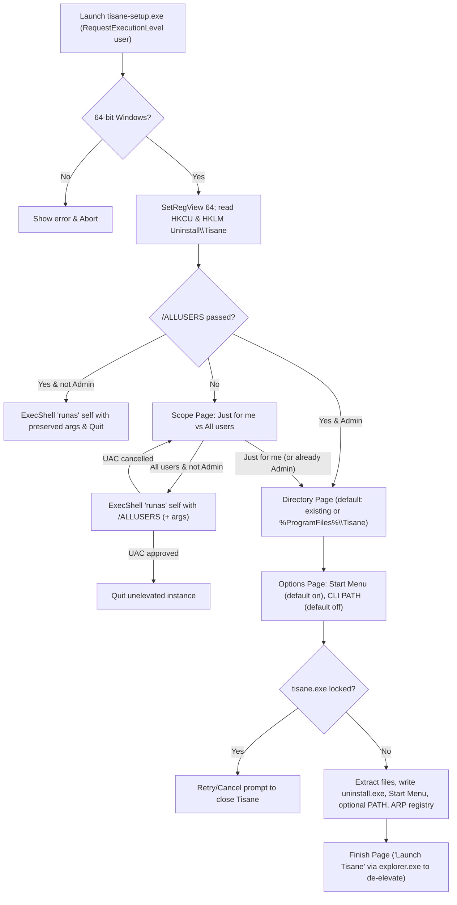

# Tisane Windows Installer Design & Implementation Plan

This document specifies the architecture, design decisions, and implementation details for packaging Tisane's Windows release binaries and bundled dictionaries into a self-contained Windows installer (`tisane-setup.exe`) built via Bazel on Linux (or Windows/macOS).

---

## 1. Requirements & Runtime Constraints

### Functional Requirements
1. **Dual install scope**:
   - **Local (per-user)**: `%LOCALAPPDATA%\Programs\Tisane` (default for fresh installs; requires no administrator privileges).
   - **Global (per-machine)**: `%ProgramFiles%\Tisane` (64-bit `Program Files`, not `Program Files (x86)`).
2. **Fresh install and in-place upgrade**:
   - Detect existing per-user (`HKCU`) and global (`HKLM`) installations, pre-selecting the existing scope, directory, and previous option choices.
   - Prompt the user to close `tisane.exe` if it is running/locked during upgrade or uninstall.
   - Overwrite binaries and bundled dictionaries cleanly while preserving user configuration (`%APPDATA%\tisane\config.toml`) and any user-added `.tsd` dictionaries in `<InstallDir>\dictionaries\`.
3. **On-demand UAC elevation**:
   - Do **not** prompt for UAC when installing or uninstalling per-user.
   - Prompt for UAC when installing or uninstalling globally so the installer has write access to `%ProgramFiles%\Tisane`, `HKLM`, and the all-users Start Menu.
4. **Optional Start Menu folder**:
   - Provide an opt-in checkbox (**checked by default**) to create a `Tisane` Start Menu folder containing shortcuts to `tisane.exe` and `uninstall.exe`.
   - When unchecked, create no Start Menu folder or shortcuts.
5. **Optional CLI `PATH` integration**:
   - Provide an opt-in checkbox (**unchecked by default**) to add the install directory to the User or Machine `PATH` so `tisane-cli`, `tisane-build`, `tisane-extract`, and `tisane-merge` can be run from any terminal.
   - Never modify `PATH` unless explicitly opted in; remove the entry on uninstall only if the installer added it.
6. **Add/Remove Programs (`Apps & Features`) integration**:
   - Register in Windows Add/Remove Programs under `HKLM` (global) or `HKCU` (per-user) with Publisher **`Brian Beck`**, URL **`https://github.com/beckbria/tisane`**, version, icon, estimated size, and a working uninstaller.

### Bundled Payload
- **Binaries (`//:windows`)**: `tisane.exe`, `tisane-cli.exe`, `tisane-build.exe`, `tisane-extract.exe`, `tisane-merge.exe`.
- **Dictionaries (`//:dictionaries`)**: all files under `dictionaries/` (e.g., `dictionaries/english-wordnet-2025-plus.tsd`).

### Runtime Compatibility
No changes to Tisane's Go binaries are needed for read-only `%ProgramFiles%\Tisane` installs because `pkg/profile/profile.go` already:
- Stores user configuration under `os.UserConfigDir()` (`%APPDATA%\tisane\config.toml` on Windows).
- Discovers bundled dictionaries relative to `os.Executable()` (`<InstallDir>\dictionaries`).

---

## 2. Packaging Technology & Toolchain Decisions

### Chosen Technology: NSIS (`makensis`)
| Option | Decision | Rationale |
| :--- | :--- | :--- |
| **NSIS (`makensis`)** | **Selected** | Native Linux compiler (`apt install nsis`, ~5 MB, no Wine), LZMA solid compression (~6.6 MB output), mature Windows wizard & uninstaller, full support for dual-scope on-demand UAC, Start Menu opt-in, ARP registration, and silent switches. |
| **Pure-Go self-extracting installer** | Rejected | Zero host dependencies, but requires maintaining custom Win32 GUI dialogs, COM `IShellLinkW` shortcuts, and self-deleting uninstaller logic. |
| **MSI via `wixl` (`msitools`)** | Rejected | `wixl` on Linux lacks WiX UI extensions (`WixUI_Advanced`), so it cannot provide interactive scope selection or Start Menu checkboxes. |
| **WiX Toolset v4+ (`.msi`)** | Rejected | Requires Windows (or Windows CI runner) to build with UI extensions; cannot cross-build locally from Linux. |
| **Inno Setup** | Rejected | Windows-only compiler (`ISCC.exe`); requires Wine on Linux, which is heavy and fragile inside Bazel. |

### Host Prerequisite vs. Bazel-Managed NSIS
NSIS is kept as a lightweight host prerequisite (`makensis` on `PATH`, exposed to Bazel actions via `build --action_env=PATH` in `.bazelrc` and `use_default_shell_env = True` in `release.bzl`), documented in `README.md`:
- Upstream NSIS only publishes prebuilt binaries for Windows, not Linux or macOS.
- The Bazel Central Registry module `rules_nsis` pulls in a large dependency graph (`hermetic_cc_toolchain`/Zig SDK, `rules_python`/Python 3.12 + PyPI, `rules_signing`, `zlib_source`) and still requires host `zlib` development headers (`zlib1g-dev`) on POSIX to compile `makensis` from source.
- Pinning an Ubuntu `.deb` directly in Bazel would break across glibc/libstdc++ versions and non-Debian hosts.

### Bazel Target Naming
- `//:windows-release` → builds the NSIS installer (`bazel-bin/tisane-setup.exe`).
- `//:windows-release-zip` → retains the portable ZIP archive (`bazel-bin/windows-release.zip`) for users who prefer a non-installer archive (may be removed in the future).

---

## 3. Architecture & File Layout

```text
tisane/
├── BUILD.bazel                         # //:windows-release (installer) & //:windows-release-zip (ZIP)
├── release.bzl                         # release_archive + windows_installer Starlark rules
├── README.md                           # NSIS host prerequisite & Bazel release build instructions
├── build/
│   ├── BUILD.bazel                     # exports_files(["windows/installer.nsi", ...])
│   ├── appicon.png                     # Source PNG converted to multi-res .ico at build time
│   └── windows/
│       └── installer.nsi               # NSIS 3.x Unicode installer & uninstaller script
└── internal/
    └── wininstaller/
        ├── BUILD.bazel                 # go_library, go_binary, go_test
        ├── main.go                     # Bazel exec helper: PNG->ICO, staging, .nsh gen, makensis
        └── main_test.go                # Unit tests (including end-to-end fake makensis stub)
```

### Installer & UAC Runtime Flow



---

## 4. Component Specifications

### 4.1 NSIS Script (`build/windows/installer.nsi`)

#### Compiler & Metadata Directives
- `Unicode True`
- `SetCompressor /SOLID lzma`
- `RequestExecutionLevel user` (essential so per-user installs never trigger UAC)
- `ManifestDPIAware true`
- Standard NSIS 3.x headers only (no third-party plugins): `MUI2.nsh`, `nsDialogs.nsh`, `LogicLib.nsh`, `x64.nsh`, `FileFunc.nsh`.
- Built-in plugins used: `UserInfo`, `nsDialogs`, `System`, `nsExec`.
- Version resource fields:
  - `VIProductVersion "${APP_VERSION_QUAD}"` (4-part numeric, e.g., `0.3.0.0`)
  - `ProductName`: `Tisane`
  - `CompanyName`: `Brian Beck`
  - `FileDescription`: `Tisane Setup`
  - `FileVersion` / `ProductVersion`: `${APP_VERSION}`
- Modern UI icons: `MUI_ICON` and `MUI_UNICON` set to `${ICON_PATH}`.

#### Required `/D` Defines (Passed by `internal/wininstaller`)
- `APP_VERSION` — semver string (defaults to `profile.Version`, e.g., `0.3.0`).
- `APP_VERSION_QUAD` — 4-component numeric version (`0.3.0.0`).
- `ICON_PATH` — path to generated multi-resolution `.ico`.
- `STAGING_DIR` — temporary directory containing staged binaries and `dictionaries/`.
- `FILES_INSTALL_NSH` — generated `.nsh` containing `SetOutPath` and `File` directives.
- `FILES_UNINSTALL_NSH` — generated `.nsh` containing exact `Delete` and `RMDir` directives.
- `OUT_FILE` — absolute output `.exe` path.

#### Supported Command-Line Flags
- `/ALLUSERS` — select global scope (auto-elevates via `ExecShell "runas"` if not Admin) and skip the Scope page.
- `/CURRENTUSER` — select per-user scope and skip the Scope page.
- `/NOSTARTMENU` — uncheck Start Menu creation (useful for silent `/S` installs).
- `/ADDTOPATH` — opt into `PATH` registration (useful for silent `/S` installs).
- `/S` — standard NSIS silent install/uninstall.
- `/D=<dir>` — standard NSIS target directory override (detected in `.onInit` via `$INSTDIR != ""`).

#### Upgrade & Preference Preservation
- Registry key: `Software\Microsoft\Windows\CurrentVersion\Uninstall\Tisane` under 64-bit registry view (`SetRegView 64`).
- On startup (`.onInit`):
  - Reads `InstallLocation` from both `HKCU` and `HKLM`.
  - If an existing global install exists and no per-user install exists, defaults scope to `"all"`; otherwise defaults to `"user"`.
  - When a scope is selected, loads `StartMenuCreated` (default `1`) and `PathAdded` (default `0`) DWORDs from that scope's uninstall key so upgrades preserve previous user choices.
- Before overwriting or deleting files, attempts `FileOpen $0 "$INSTDIR\tisane.exe" a`; on error, displays a `Retry / Cancel` dialog asking the user to close Tisane.

#### Safe `PATH` Modification (Avoiding 1024-Byte NSIS Truncation)
Standard NSIS string operations truncate at `NSIS_MAX_STRLEN` (1024 chars), which can corrupt long Windows `PATH` variables. Instead:
- The installer passes `$INSTDIR` and `"Machine"` / `"User"` via process environment variables (`TISANE_INSTALL_DIR`, `TISANE_PATH_SCOPE`) using `System::Call 'Kernel32::SetEnvironmentVariable(...)'` (avoiding all quoting/escaping issues with spaces or parentheses).
- Invokes `WindowsPowerShell\v1.0\powershell.exe` via `nsExec::ExecToStack` using `[Environment]::GetEnvironmentVariable("Path", $scope)` and `[Environment]::SetEnvironmentVariable("Path", ..., $scope)`:
  - **Install** (only when `$AddToPath == 1`): splits on `;`, checks case-insensitively (trimming trailing `\`) to avoid duplicates, appends `$dir`, and writes back (automatically broadcasting `WM_SETTINGCHANGE`).
  - **Uninstall** (only when `PathAdded == 1` in registry): filters out the matching directory and writes back.

#### Add/Remove Programs Registration
Written to `HKLM` (global) or `HKCU` (per-user) under `Software\Microsoft\Windows\CurrentVersion\Uninstall\Tisane`:
- `DisplayName` = `"Tisane"`
- `DisplayVersion` = `"${APP_VERSION}"`
- `Publisher` = `"Brian Beck"`
- `URLInfoAbout` = `"https://github.com/beckbria/tisane"`
- `DisplayIcon` = `"$INSTDIR\tisane.exe,0"`
- `InstallLocation` = `"$INSTDIR"`
- `UninstallString` = `'"$INSTDIR\uninstall.exe"'`
- `QuietUninstallString` = `'"$INSTDIR\uninstall.exe" /S'`
- `NoModify` = `DWORD 1`
- `NoRepair` = `DWORD 1`
- `EstimatedSize` = computed in KB via `${GetSize} "$INSTDIR" "/S=0K"`
- Installer state metadata: `InstallMode` (`"all"` / `"user"`), `StartMenuCreated` (`DWORD`), `PathAdded` (`DWORD`).

#### De-Elevated App Launch on Finish
The Finish page's "Launch Tisane" checkbox calls `Exec '"$WINDIR\explorer.exe" "$INSTDIR\tisane.exe"'` so that even after an elevated global install, `tisane.exe` launches at medium integrity (unelevated).

#### Uninstaller Behavior (`un.onInit` & `Section "Uninstall"`)
- Detects whether `$INSTDIR` matches `HKLM` or `HKCU` `InstallLocation`.
- If global (`HKLM`) and not running as Administrator, re-launches `"$INSTDIR\uninstall.exe"` with `ExecShell "runas"` (preserving CLI parameters via `${un.GetParameters}`) and exits the unelevated instance.
- Uses `SetShellVarContext all` (global) or `current` (per-user).
- Deletes only the exact installed binaries and bundled dictionaries listed in `${FILES_UNINSTALL_NSH}`, plus `uninstall.exe` and Start Menu shortcuts/folder.
- Uses non-recursive `RMDir` on `$INSTDIR\dictionaries` and `$INSTDIR` so any user-added `.tsd` files remain intact.
- Removes the `PATH` entry if `PathAdded == 1`, then deletes the Uninstall registry key.

---

### 4.2 Go Build Helper (`internal/wininstaller`)

#### CLI Interface (`internal/wininstaller/main.go`)
- `-script` (required): path to `build/windows/installer.nsi`.
- `-icon` (required): path to `build/appicon.png`.
- `-out` (required): output `.exe` path.
- `-version` (optional): version string (defaults to `profile.Version`).
- `-makensis` (optional): explicit path to `makensis` binary (defaults to `exec.LookPath("makensis")` with an actionable error message if missing).
- `-bin` (repeatable): `<src>=<dst>` binary mapping.
- `-file` (repeatable): `<src>=<dst>` regular file mapping (e.g., `dictionaries/english-wordnet-2025-plus.tsd`).

#### Execution Steps
1. Parse, normalize, validate (rejecting duplicate targets and `../` traversal), and deterministically sort entries.
2. Create an isolated temp workspace (`os.MkdirTemp("", "tisane-wininstaller-*")`), cleaned up on exit.
3. Convert `-icon` PNG into a multi-resolution Windows `.ico` (`256, 128, 64, 48, 32, 24, 16`) using `github.com/tc-hib/winres` (`winres.NewIconFromResizedImage` + `ico.SaveICO`).
4. Copy all `-bin` and `-file` entries into `<workDir>/staging/<dst>`.
5. Generate `<workDir>/files_install.nsh` (grouped by directory with `SetOutPath "$INSTDIR[\<subdir>]"` and `File "<hostPath>"`, escaping `$` → `$$` and `"` → `$\"`) and `<workDir>/files_uninstall.nsh` (exact `Delete "$INSTDIR\<rel>"` and deepest-first `RMDir "$INSTDIR\<dir>"`).
6. Invoke `makensis -V2` with all `-D...` defines and the absolute path to `installer.nsi`.

#### Unit Tests (`internal/wininstaller/main_test.go`)
- `TestFormatVersionQuad`: semver, 4-part, pre-release/build metadata stripping, partial/empty versions.
- `TestParseEntries`: deterministic sorting, duplicate detection, path traversal rejection, invalid mapping format.
- `TestGenerateInstallAndUninstallNSH`: root + nested directories, `$` escaping, deepest-first `RMDir` ordering.
- `TestWriteICOFromPNG`: generates a synthetic PNG, writes `.ico`, verifies ICO header (`reserved=0`, `type=1`, `count=7`).
- `TestBuildInstallerWithFakeMakensis`: invokes `run()` with a POSIX shell stub for `makensis`, verifying staging, `.ico`/`.nsh` creation, `-D` flags, and output file generation.

---

### 4.3 Bazel Rules (`release.bzl`, `BUILD.bazel`, `build/BUILD.bazel`)

- **`build/BUILD.bazel`**: exports `windows/installer.nsi` in `exports_files`.
- **`release.bzl`**: defines `windows_installer` rule:
  - Attributes: `binaries`, `dictionaries`, `icon` (`.png`), `script` (`.nsi`), `version` (optional string), `out` (output), `_builder` (`//internal/wininstaller`, `cfg = "exec"`).
  - Sets `use_default_shell_env = True` on `ctx.actions.run` so `makensis` is resolved from `PATH`.
- **`BUILD.bazel`**:
  - `windows_installer(name = "windows-release", out = "tisane-setup.exe", binaries = [":windows"], dictionaries = [":dictionaries"], icon = "//build:appicon.png", script = "//build:windows/installer.nsi")`
  - `release_archive(name = "windows-release-zip", out = "windows-release.zip", ...)`

---

## 5. Verification Checklist

### Automated Verification
```bash
bazel test //internal/wininstaller/... //internal/releasepkg/...
bazel test //...
go test -race -v ./internal/wininstaller
bazel build //:linux-release //:windows-release //:windows-release-zip
file bazel-bin/tisane-setup.exe
# Expected: PE32 executable for MS Windows ... Nullsoft Installer self-extracting archive
```

### Manual Verification (Windows 10/11)
- [x] **Fresh per-user install**: Installs to `%LOCALAPPDATA%\Programs\Tisane` without UAC; appears in Windows Add/Remove Programs (`Publisher: Brian Beck`); uninstalls cleanly.
- [x] **Fresh global install**: Prompts for UAC; installs to `%ProgramFiles%\Tisane`; appears in Windows Add/Remove Programs; uninstalls cleanly.
- [x] **Start Menu opt-out**: Unchecking the Start Menu option creates no Start Menu folder or shortcut.
- [ ] **In-place upgrade**: Re-running a newer installer over an existing per-user or global install auto-detects the existing scope/directory, updates binaries, and preserves user config (`%APPDATA%\tisane\config.toml`) and custom `.tsd` dictionaries.
