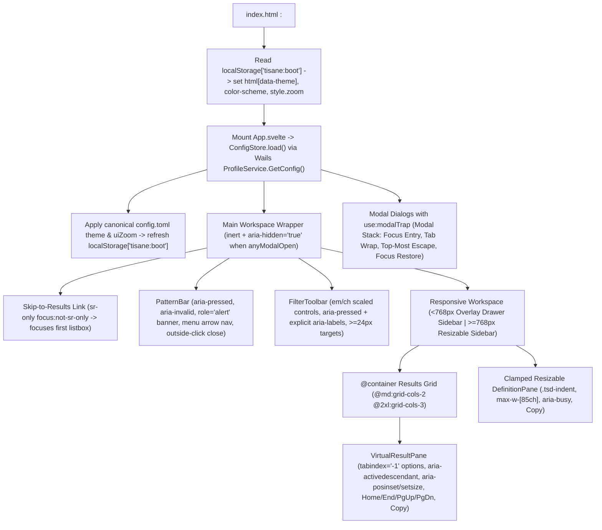

# Tisane UI, Accessibility, Theming & Responsiveness Design Specification

This document records the UI/UX and accessibility audit of the Tisane GUI (`cmd/tisane`), the architectural rationale behind each design decision, and the complete technical specification for implementing the five-part overhaul across Go (`pkg/profile`, `cmd/tisane/app`, `cmd/tisane`) and Svelte 5 (`cmd/tisane/frontend`). Another contributor or AI agent can reproduce the entire implementation directly from this specification.

---

## 1. Motivation & Baseline Audit Findings

Prior to v0.6.2, Tisane's Svelte 5 + Tailwind CSS v4 + Wails v3 GUI already had strong reactive state architecture (`.svelte.ts` rune stores, `$state.raw` match buffers, `@tanstack/svelte-virtual` list virtualization, 60 ms debounced span validation, and strict CSP + backend RTF sanitization), but suffered from five classes of usability and accessibility defects:

### 1.1 UI Best Practices & Focus Hygiene Gaps
1. **No Modal Focus Management**: None of the 5 modal dialogs (`SettingsModal`, `FontSettingsModal`, `AboutModal`, `BuildDictionaryModal`, `MergeWordListsModal`) moved focus inside upon opening, trapped `Tab`/`Shift+Tab` within the dialog, marked background controls `inert`, or restored focus to the invoking button on close.
2. **Stacked Modal `Escape` Bug**: `SettingsModal` can open two child dialogs (`FontSettingsModal` and the *Reset All Settings* confirmation modal). Pressing `Escape` hit `App.svelte`'s global window listener (`else if (showSettings) showSettings = false`), closing the **entire parent `SettingsModal`** and discarding unsaved macro/provider edits instead of closing only the top-most child dialog.
3. **Missing Outside-Click Dismissal**: Clicking outside `PatternBar`'s `Recent Queries` dropdown or `Syntax Quick Reference` popover left them floating open over search results.
4. **Stripped `:focus-visible` Outlines (WCAG 2.4.7)**: Multiple controls (`VirtualResultPane`, `sidebar-resizer`, `definition-resizer`, and form inputs) used `focus:outline-none` without replacement `:focus-visible` indicators.
5. **Unstyled RTF Indentation (`.tsd-indent`)**: `pkg/lookup/rtf.go` parses RTF `\li` left-indent control words and emits `<p class="tsd-par tsd-indent">`, yet `cmd/tisane/frontend/src/app.css` had no `.tisane-def .tsd-indent` rule, causing hierarchical sub-senses in `.tsd` dictionaries to render flat.
6. **Missing Copy-to-Clipboard Workflow**: Because result rows are `<button role="option">` elements (`user-select: none`), users had no way to copy a matched headword (`Ctrl+C`), copy all matches in a dictionary pane, or copy plain-text definitions.

### 1.2 Screen Reader Accessibility Blockers (WCAG 4.1.2 & WAI-ARIA 1.2 APG)
1. **Nested Tab Trap in Virtualized Listbox**: `VirtualResultPane` placed focusable `<button type="button" role="option">` elements (implicit `tabindex="0"`) inside a `<div role="listbox" tabindex="0">`. Keyboard and screen-reader users had to press `Tab` 25–40 times per pane (100+ times across 3–4 tiled panes) to reach `DefinitionPane`, instead of a single `Tab` stop per listbox with `aria-activedescendant`.
2. **Wrong Virtualized Set Counts**: Because `@tanstack/svelte-virtual` mounts ~25 DOM nodes at a time, screen readers announced *"1 of 25"* instead of *"1 of 241,350"* due to missing `aria-posinset` and `aria-setsize`.
3. **Ambiguous Option Accessible Names**: Concatenated child text read raw glyphs and unexplained numbers aloud (e.g., `"matador 7"` for a 7-letter word, or `📖` on a roleless `<span>`).
4. **Incomplete Listbox Keyboard Navigation**: Only `ArrowUp` and `ArrowDown` were supported; `Home`, `End`, `PageUp`, `PageDown`, and `Enter` were missing.
5. **Missing `aria-pressed` on Stateful Toggles**:
   - Search mode buttons (`Word Search` / `Full Text (FTS)`) had no `aria-pressed`.
   - Entry category filters (`abc`, `Abc`, `a-b`, `a b`) conveyed active/inactive state **solely via color and CSS `line-through`**, with cryptic visible codes and no `aria-pressed` or descriptive `aria-label`.
   - Exact-length pin (`=` / `–`), `Dedupe`, and `⊞ Tiled` / `≡ Unified` layout buttons lacked `aria-pressed` and exposed raw symbols (`⊞`, `≡`, `⚙`, `▾`, `↗`) without `aria-hidden="true"`.
6. **Silent Dynamic Updates**: Live validation errors (`PatternBar`), search completion counts and errors (`App.svelte`), loading state (`DefinitionPane`), and dictionary build/merge results (`BuildDictionaryModal`, `MergeWordListsModal`) lacked `aria-invalid`, `aria-describedby`, `aria-busy`, `role="alert"`, and `role="status"` live regions.

### 1.3 WCAG 2.1 AA Color Contrast Failures & Dark-Only Palette
While primary text (`slate-100` on `slate-950` = `18.41:1`) and amber CTAs (`9.39:1`) met AAA, several secondary text and UI boundary tokens failed WCAG 2.1 AA (`4.5:1` for small text, `3.0:1` for non-text UI components under SC 1.4.11):
- `text-slate-600` on `bg-slate-950` = **`2.66:1`** (result row word lengths, `Enum` placeholder).
- `text-slate-500` on `bg-slate-900` = **`3.75:1`** (sidebar subtitle, inactive category toggles, pane subtitles, definition empty-state copy, modal hints).
- `text-slate-500` on `bg-slate-950` = **`4.24:1`** (status bar macro echoes, empty workspace message, Clear `×`).
- Compounded opacity: `text-slate-400` inside `opacity-60` sidebar action groups dropped to **`3.39:1`**; `Stop` button hover (`white` on `rose-500`) dropped from `4.70:1` (`rose-600`) to **`3.67:1`**.
- Non-text control borders: `border-slate-800` / `border-slate-700` on `slate-950` / `slate-900` = **`1.38:1` – `1.95:1`**; scrollbar thumb `#334155` on `#0f172a` = **`1.72:1`**; selected result row tint `bg-amber-500/20` on `slate-950` = **`1.35:1`** with no border cue.
- No **Light** or **System (`prefers-color-scheme`)** theme for daylight use or users with astigmatism (halation on dark backgrounds), and missing `color-scheme` on `:root` risked white OS `<select>` popups in dark mode.

### 1.4 High-DPI, UI Zoom & Font Scaling Defects
1. **No Global UI Zoom (`Ctrl+=` / `Ctrl+-` / `Ctrl+0`)**: Especially on Linux GTK3/X11 fractional-DPI setups (125% / 150%), users could not scale the full UI (icons, checkboxes, spacing, modals) together.
2. **Hardcoded `px` Classes Overriding Custom Font Variables**: `FilterToolbar` set `font-size: var(--tisane-font-toolbar-size)` on its wrapper, but child elements specified `text-[11px]`, `text-xs`, and `w-13` (`52px`), making the *Filter Toolbar* font slider in `FontSettingsModal` nearly inert. Similarly, `PatternBar`'s `Enum` input used fixed `w-20` (`80px`), and `VirtualResultPane` hardcoded `text-[10px] w-3.5` on badges/word lengths.
3. **Sub-24px Pointer Targets (WCAG 2.2 AA SC 2.5.8)**: Compact icon buttons (`↑`, `↓`, `×`, `←`, `→`, modal `✕`) measured `16×18px`–`24×20px`.

### 1.5 Multi-Screen & Split-Screen Layout Constraints
1. **Split-Screen Blocked by `MinWidth: 920`**: On a `1920×1080` laptop at **125% Windows DPI**, logical resolution is `1536×864`, making a 50% side-by-side snap **`768px` wide** (`683px` on `1366×768`). `MinWidth: 920, MinHeight: 600` in `cmd/tisane/main.go` prevented snapping Tisane next to a crossword puzzle in a browser.
2. **Tiled Grid Ignored Sidebar Width**: `App.svelte` used viewport media queries (`md:grid-cols-3` at `window.innerWidth >= 768px`) instead of CSS Container Queries (`@container`), forcing three `min-w-[220px]` panes (`680px+`) into a `420px` workspace when the sidebar was expanded—clipping the 3rd dictionary pane off-screen.
3. **Narrow / Server-Mode Viewports (`< 768px`) & Ultrawide Readability**: Below `768px`, an expanded `272px` inline sidebar crushed the results workspace, and `Syntax Cheatsheet` (`right-4 w-full max-w-xl`) overflowed the left viewport edge. On 4K/ultrawide displays, `DefinitionPane` prose stretched to `180+ ch` per line, while on `480px`-tall windows a previously saved `400px` `definitionHeight` could starve results vertically.

---

## 2. Key Architectural Decisions & Trade-Offs

### 2.1 Persisting `theme` and `ui_zoom` in `config.toml` + `localStorage` Pre-Paint Boot Cache
| Storage Layer | Role in Tisane | Rationale |
| :--- | :--- | :--- |
| **`config.toml` (`pkg/profile`)** | **Canonical source of truth** | Matches `layout_mode`, `sidebar_width`, `sidebar_collapsed`, `definition_height`, `definition_collapsed`, and `[fonts]`. Honors `TISANE_CONFIG` isolation, dotfile backups, server-mode port changes, and atomic `ProfileService.ResetConfig`. |
| **`localStorage['tisane:boot']`** | **Synchronous pre-paint cache only** | Because `ProfileService.GetConfig()` is asynchronous over Wails IPC, reading `{ theme, uiZoom }` synchronously in `<head>` before `<body>` paints eliminates any 1-frame dark-to-light or 100%-to-130% startup flash. Cleared on `ResetConfig`. |

### 2.2 Preserving Strict CSP (`script-src 'self'`) for Pre-Paint Initialization
`cmd/tisane/frontend/index.html` enforces `script-src 'self'` (forbidding `'unsafe-inline'` scripts). Rather than weakening CSP with `'unsafe-inline'`, pre-paint initialization lives in a dedicated static script `cmd/tisane/frontend/public/boot.js` loaded synchronously via `<script src="/boot.js"></script>` in `<head>`.

### 2.3 Tailwind CSS v4 CSS Variable Remapping for Light/Dark Themes
Tailwind CSS v4 compiles color utilities (`bg-slate-950`, `text-slate-200`, `border-slate-600`, `text-amber-300`, etc.) directly to CSS custom properties (`var(--color-slate-950)`, etc.). By defining `[data-theme="light"]` overrides on those custom properties in `src/app.css`—while using `text-neutral-950` (`#0a0a0a`, invariant across themes) on solid `bg-amber-500` CTA buttons and `hover:text-slate-100` instead of `hover:text-white` on neutral surfaces—both Dark and Light modes achieve 100% WCAG AA/AAA compliance without littering 10 components with `dark:` conditional class duplication.

### 2.4 Root CSS `zoom` with `h-full w-full` Containment & Drag Compensation
Applying global UI zoom via `document.documentElement.style.zoom = String(uiZoom / 100)` scales typography, SVG icons, checkboxes, borders, and modal spacing uniformly. Two subtle WebKit/Chromium pitfalls must be handled:
1. **`h-full` instead of `h-screen` (`100vh`)**: Under CSS `zoom != 1`, `100vh`/`100vw` can exceed the zoomed viewport in WebKit, whereas `height: 100%` (`h-full w-full` chained through `html, body, #app, [data-testid="app-root"]`) resolves cleanly to the zoomed initial containing block at every zoom level (`75%–200%`) and avoids mobile dynamic-toolbar clipping.
2. **Splitter Pointer Delta Scaling**: Mouse events report `clientX` / `clientY` in unzoomed viewport coordinates while sidebar width and definition height are CSS pixels inside the zoomed root. Dividing `(moveEvent.clientX - startX)` and `window.innerWidth` by `zoomScale = uiZoom / 100` keeps splitter dragging 1:1 locked to the cursor.

### 2.5 Decomposition into Five Atomic Commits
1. **Theme Switcher, Boot Cache & WCAG Contrast** (`pkg/profile`, `cmd/tisane/app`, `cmd/tisane`, `public/boot.js`, `app.css`, components)
2. **Screen Reader Accessibility & Modal Focus Trapping** (`src/lib/actions/modalTrap.ts`, WAI-ARIA listbox/menus/toggles/live regions)
3. **Global UI Zoom & Proportional Font Scaling** (`ui_zoom` in profile/menus/Settings, `em`/`ch` sizing, `24×24px` pointer targets)
4. **Multi-Screen & Split-Screen Responsiveness** (`640×480` min window, `@container` tiled grid, `< 768px` drawer sidebar, dynamic height clamping, `85ch` prose)
5. **Match & Definition Copy Actions + Docs/Version** (`src/lib/clipboard.ts`, pane/definition Copy buttons + `Ctrl/Cmd+C`, `VERSION` bump, docs)

---

## 3. Architecture & Runtime Flow



---

## 4. Component-by-Component Implementation Specification

### 4.1 Profile & Backend Configuration (`pkg/profile` & `cmd/tisane/app`)

#### `pkg/profile/profile.go` & `pkg/profile/toml.go`
- Constants:
  - `DefaultTheme = "dark"`
  - `DefaultUIZoom = 100`, `MinUIZoom = 75`, `MaxUIZoom = 200`
- Normalizers:
  - `NormalizeTheme(s string) string`: trims & lowercases; `"light"` -> `"light"`, `"system"` or `"auto"` -> `"system"`, anything else -> `"dark"`.
  - `NormalizeUIZoom(z int) int`: if `z <= 0` returns `100`; otherwise clamps to `[75, 200]`.
- `Config` struct fields & TOML keys:
  - `Theme string` (`json:"theme"`, TOML `theme = "dark"`)
  - `UIZoom int` (`json:"uiZoom"`, TOML `ui_zoom = 100`)
- Always normalize `Theme` and `UIZoom` in `DefaultConfig()`, `MarshalTOML()`, `ParseTOML()`, and `app.State.cloneConfigLocked()`.

#### `cmd/tisane/app/events.go` & `cmd/tisane/app/profile_service.go`
- Add Wails event constants:
  - `EventUISetTheme = "ui:set-theme"` (payload: `"dark" | "light" | "system"`)
  - `EventUIZoom = "ui:zoom"` (payload: `"in" | "out" | "reset"`)
- Add pointer fields to `ConfigPatch`:
  - `Theme *string` (`json:"theme,omitempty"`)
  - `UIZoom *int` (`json:"uiZoom,omitempty"`)
- In `ProfileService.UpdateConfig`, apply `NormalizeTheme` / `NormalizeUIZoom` before saving atomically. Do **not** add new exported methods to bound services so the 21-method Wails FQN contract in `cmd/tisane/main_test.go` remains unchanged.

#### `cmd/tisane/main.go` & `cmd/tisane/main_test.go`
- In `buildAppMenu` under `View`:
  - Add `Theme` submenu with `Dark`, `Light`, `System` items emitting `EventUISetTheme`.
  - Add separator + `Zoom In` (`CmdOrCtrl+=` -> `EventUIZoom`, `"in"`), `Zoom Out` (`CmdOrCtrl+-` -> `EventUIZoom`, `"out"`), and `Actual Size` (`CmdOrCtrl+0` -> `EventUIZoom`, `"reset"`).
- In `main()`:
  - Set initial `WebviewWindowOptions.BackgroundColour` to `RGB(255, 255, 255)` when `profileSvc.GetConfig().Theme == "light"`, otherwise `RGB(2, 6, 23)`.
  - Set `MinWidth: 640`, `MinHeight: 480` (down from `920×600`).
- In `cmd/tisane/main_test.go`: assert embedded asset server returns `200 OK` for `/boot.js`.

---

### 4.2 Pre-Paint Boot Script & Theme/Contrast Stylesheet

#### `cmd/tisane/frontend/public/boot.js` & `cmd/tisane/frontend/index.html`
- Reference `<script src="/boot.js"></script>` inside `<head>` of `index.html`.
- `boot.js` wraps `window.localStorage.getItem('tisane:boot')` in `try/catch`, parses `{ theme, uiZoom }`, resolves `'system'` via `window.matchMedia('(prefers-color-scheme: light)').matches`, and sets:
  - `document.documentElement.dataset.theme = resolved` (`'dark'` or `'light'`)
  - `document.documentElement.style.colorScheme = resolved`
  - `document.documentElement.style.zoom = String(zoom / 100)` when `zoom !== 100` (`75 <= zoom <= 200`).

#### `cmd/tisane/frontend/src/app.css` Token & Accessibility Rules
All foreground/background pairs must satisfy **≥ 4.5:1** for text and **≥ 3.0:1** for UI control borders/scrollbars across both themes:

| CSS Variable | Dark (`:root`) | Light (`[data-theme="light"]`) | Purpose & Verified Contrast |
| :--- | :--- | :--- | :--- |
| `--color-slate-950` | `#020617` | `#ffffff` | App canvas, inputs, result panes, cards |
| `--color-slate-900` | `#0f172a` | `#f1f5f9` | Headers, sidebar, toolbar, modal chrome |
| `--color-slate-800` | `#1e293b` | `#e2e8f0` | Dividers, secondary chips, hover fills |
| `--color-slate-700` | `#334155` | `#cbd5e1` | Secondary button hover |
| `--color-slate-600` | `#64748b` | `#64748b` | Input/select/checkbox borders & scrollbar thumb (`3.75:1–4.76:1`) |
| `--color-slate-400` | `#94a3b8` | `#475569` | Muted labels, word lengths, placeholders (`5.71:1–7.87:1`) |
| `--color-slate-300` | `#cbd5e1` | `#334155` | Secondary text (`9.45:1–12.02:1`) |
| `--color-slate-200` | `#e2e8f0` | `#1e293b` | Result words, definition body (`14.63:1–16.36:1`) |
| `--color-slate-100` | `#f1f5f9` | `#0f172a` | Primary headings & input text (`17.85:1–18.41:1`) |
| `--color-amber-400` / `300` | `#fbbf24` / `#fcd34d` | `#b45309` / `#92400e` | Focus rings (`>= 5.0:1`), warnings, amber badge text (`>= 5.75:1`) |
| `--color-emerald-300` | `#6ee7b7` | `#065f46` | `+ADDED` balance & `Dedupe` badge text (`>= 6.67:1`) |
| `--color-rose-400` / `300` | `#fb7185` / `#fda4af` | `#be123c` / `#9f1239` | Validation errors & `-OMITTED` badge text (`>= 5.74:1`) |
| `--color-sky-300` / `purple-300` | `#7dd3fc` / `#d8b4fe` | `#075985` / `#6b21a8` | `fts`, `Text mention`, and `Cross-ref` badges (`>= 6.50:1`) |

Additional required CSS rules in `src/app.css`:
- **CTA & Danger Button Invariants**: Solid `bg-amber-500` buttons must use `text-neutral-950 hover:brightness-105` (`9.22:1` in both themes); danger/Stop buttons (`bg-rose-600 text-white`) must use `hover:bg-rose-700` (`6.29:1`, never `hover:bg-rose-500` which drops to `3.67:1`); neutral hover text must use `hover:text-slate-100` (never `hover:text-white`).
- **RTF Sub-Sense Indentation**: `.tisane-def .tsd-indent { padding-left: 1.25rem; }`.
- **Keyboard Focus Ring**: `button:focus-visible, a:focus-visible, select:focus-visible, input[type="checkbox"]:focus-visible, input[type="radio"]:focus-visible, input[type="range"]:focus-visible { outline: 2px solid var(--color-amber-400); outline-offset: 2px; }`.
- **Motion & Forced Colors**: `@media (prefers-reduced-motion: reduce)` collapses animation/transition durations to `0.01ms`; `@media (forced-colors: active)` applies `2px solid Highlight` outlines to `[role="option"][aria-selected="true"]` and `button[aria-pressed="true"]`.

---

### 4.3 Stacked Modal Focus Trap (`src/lib/actions/modalTrap.ts`)

Create a module-level stack `modalStack: ModalStackEntry[]` and Svelte action `modalTrap(node, { onClose, disabled })`:
1. **Mount**:
   - Capture `previousActive = document.activeElement`.
   - Push `{ node, getOptions }` onto `modalStack`; ensure `tabindex="-1"` on `node`.
   - In `queueMicrotask`, if `entry` is still top-of-stack and focus is outside `node`, focus `[data-autofocus]:not([disabled])` or the first non-disabled, non-`inert`, non-`aria-hidden` focusable element inside `node` *(do not filter by `offsetParent !== null`, which is always `null` in `jsdom`)*.
2. **Tab Wrapping**:
   - When `entry` is top-of-stack and `e.key === 'Tab'`, query current focusable descendants: `Shift+Tab` on first (or outside) wraps to last; `Tab` on last (or outside) wraps to first.
3. **Top-Most `Escape` & Backdrop Dismissal**:
   - Export `closeTopModalOnEscape(): boolean`: if `modalStack` is non-empty, invoke `top.onClose()` when `!top.disabled` and return `true` either way so `App.svelte`'s global `Escape` listener never closes a parent dialog or cancels an active background search while a modal is open.
   - Clicking directly on the backdrop (`e.target === node`) invokes `onClose()` when `entry` is top-of-stack and `!disabled`.
4. **Unmount & Focus Restoration**:
   - Remove `entry` from `modalStack`.
   - In `queueMicrotask`, if `previousActive` is still in `document` and within the new top-of-stack modal (or no modal remains), call `previousActive.focus()`; otherwise focus the first focusable element of the remaining top modal.
5. **Background Isolation**:
   - In `App.svelte`, wrap the entire non-modal workspace in `<div inert={anyModalOpen ? true : undefined} aria-hidden={anyModalOpen ? 'true' : undefined}>`.
   - In `SettingsModal.svelte`, mark `<div data-testid="settings-modal">` with `inert` + `aria-hidden="true"` whenever `showFontDialog || showResetConfirm` is true (keeping child modals rendered as siblings outside that `div`).

---

### 4.4 WAI-ARIA Component Contracts

1. **`VirtualResultPane.svelte` (Single-Tab-Stop Virtualized Listbox)**:
   - Scroll container: `role="listbox"`, `tabindex="0"`, `aria-label="{title} matches"`, `aria-activedescendant={activeDescendantId}` (set only when `resolvedActiveIndex` is currently mounted in `$virtualizer.getVirtualItems()`).
   - Each virtualized `<button type="button" role="option">`:
     - `id="{testId}-opt-{vRow.index}"`, `tabindex="-1"` *(critical: prevents 25+ tab stops per pane)*.
     - `aria-selected={isSelected}`, `aria-posinset={vRow.index + 1}`, `aria-setsize={items.length}`.
     - `aria-label` formatted cleanly as `"{word}, {annotation}, omits {X}, adds {Y}, {dict}, has local definition | {N} letters"`, while inner visual `<div>`s carry `aria-hidden="true"`.
     - Selection visual cue: `border-l-2 border-l-amber-400 bg-amber-500/20 text-amber-100`.
     - Clicking an option sets `selectedIndex` and calls `scrollEl?.focus({ preventScroll: true })`.
   - Keyboard navigation on `listbox`: `ArrowDown`, `ArrowUp`, `Home` (`0`), `End` (`items.length - 1`), `PageDown` / `PageUp` (`Math.max(1, Math.floor(clientHeight / rowHeight) - 1)`), and `Enter` (`onDoubleClick`).
2. **`PatternBar.svelte` & `FilterToolbar.svelte`**:
   - Set `aria-pressed` on `mode-word-btn`, `mode-fts-btn`, `exact-length-pin`, `cat-lowercase`..`cat-phrase` (with `aria-label="Include lowercase entries"`, etc.), `toggle-dedupe-btn`, `layout-tiled-btn`, and `layout-unified-btn`.
   - Set `aria-invalid` and `aria-describedby="pattern-validation-banner"` on `pattern-input`; set `role={!validation.valid ? 'alert' : 'status'}` and `aria-live="polite"` on `validation-banner`.
   - Add `<svelte:window onclick={...}>` outside-click dismissal + `ArrowDown`/`ArrowUp`/`Home`/`End`/`Escape` menu item focus navigation on `Recent Queries` (`role="menu"`), `? Syntax` (`aria-expanded`, `aria-controls`), and `DictionarySidebar`'s `+ Add` menu (`aria-label="Add or build dictionaries"`).
3. **`App.svelte` & `DefinitionPane.svelte` Landmarks & Live Announcements**:
   - First element in workspace: `Skip to results` link (`sr-only focus:not-sr-only`) that focuses `[data-testid="results-workspace"] [role="listbox"]`.
   - Polite screen-reader announcer (`role="status" aria-live="polite" aria-atomic="true" class="sr-only"`) announcing `"Search complete: X matches found across Y dictionaries."` only when `hasCompletedSearch && !isSearching` (avoiding 25 ms streaming progress spam), plus `role="alert"` on error banners across the status bar and modals, and `aria-busy={isLoading}` on `DefinitionPane`'s body.

---

### 4.5 Proportional Font Scaling, Target Sizes & Responsive Layout

1. **Proportional `em` / `ch` Sizing**:
   - In `FilterToolbar.svelte`, use `text-[0.92em]` / `text-[1em]`, `h-[1.15em] w-[1.15em]` icons, and `w-[5ch]` length inputs so `--tisane-font-toolbar-size` scales all toolbar children proportionally.
   - In `PatternBar.svelte`, size `enum-input` to `w-[7.5ch]` so it scales with `--tisane-font-pattern-size`.
   - In `VirtualResultPane.svelte`, size secondary row badges with `font-size: calc(var(--tisane-font-results-size) * 0.78)` and `min-w-[2.2ch]` / `max-w-[12ch]`.
   - Enforce `min-h-6 min-w-6` (`24×24` CSS px, WCAG 2.2 AA `2.5.8`) on all compact icon/stepper/close buttons.
2. **Container Queries, Compact Drawer & Viewport Clamping**:
   - Mark `results-workspace` with `@container` and set `tiledGridClass` to `grid-cols-1` (`n <= 1`), `grid-cols-1 @md:grid-cols-2` (`n === 2`), and `grid-cols-1 @md:grid-cols-2 @2xl:grid-cols-3` (`n >= 3`) so column count responds to actual results container width rather than window width.
   - Track `viewportWidth` and `viewportHeight` via `<svelte:window onresize={...}>` divided by `zoomScale`:
     - When `viewportWidth / zoomScale < 768` and `!sidebarCollapsed`, render `DictionarySidebar` inside an overlay drawer (`absolute inset-y-0 left-0 z-30 shadow-2xl`) above a dismissible backdrop (`data-testid="sidebar-drawer-backdrop"`).
     - Clamp rendered `effectiveDefinitionHeight` to `Math.min(rawHeight, Math.max(MIN_DEFINITION_HEIGHT, Math.floor((viewportHeight / zoomScale) * 0.55)))` without overwriting the user's persisted `config.definitionHeight`.
   - Constrain `.tisane-def` in `DefinitionPane.svelte` to `max-w-[85ch]`, clamp `syntax-cheatsheet` with `right-3 left-3 sm:right-4 sm:left-auto sm:w-[36rem]`, and hide right-hand status-bar macro echoes below `sm` (`hidden sm:flex`).

---

### 4.6 Match & Definition Copy Actions (`src/lib/clipboard.ts`)

1. **`copyTextToClipboard(text: string): Promise<boolean>`**:
   - Attempt `navigator.clipboard.writeText(text)` first; fall back to an off-screen `readonly` `<textarea>` + `document.execCommand('copy')` (restoring prior `document.activeElement` focus) so copying also works in non-HTTPS `http://<lan-ip>:8080` Wails server mode.
2. **`VirtualResultPane.svelte`**:
   - Render `{testId}-copy-btn` in the pane header whenever `items.length > 0` to copy `items.map((m) => m.word).join('\n')`.
   - Handle both `Ctrl/Cmd+C` in `handleKeydown` and native `oncopy` on the `role="listbox"` (when `window.getSelection()` is empty) to copy the active headword (`items[resolvedActiveIndex]`), displaying `✓ Copied` for `1500ms` and updating an `sr-only` `role="status"` live region.
3. **`DefinitionPane.svelte`**:
   - Render `copy-definition-btn` in the header whenever local entries exist, copying `"{word}\n\n[{dict}]\n{text}"` joined across entries with `✓ Copied` visual and `aria-live` feedback.

---

## 5. Verification Checklist

1. **Frontend Static Analysis & Component Tests**:
   ```bash
   cd cmd/tisane/frontend
   npm run check   # 0 errors, 0 warnings
   npm test        # 24 Vitest suites covering themes, boot cache, ARIA listbox, focus trap, zoom, drawer, and copy
   npm run build   # Refresh embedded dist/ bundle (including dist/boot.js)
   ```
2. **Go Race & Wails Binding / Asset Tests**:
   ```bash
   go test -race ./pkg/... ./cmd/tisane-build ./cmd/tisane-extract ./cmd/tisane-merge ./cmd/tisane-cli ./cmd/tisane/app ./internal/...
   CGO_ENABLED=0 go test -tags purego,gtk3 -v ./cmd/tisane
   ```
3. **Hermetic Bazel Test & Cross-Platform Release Verification**:
   ```bash
   bazel test //...
   bazel build //:linux //:windows
   ```
